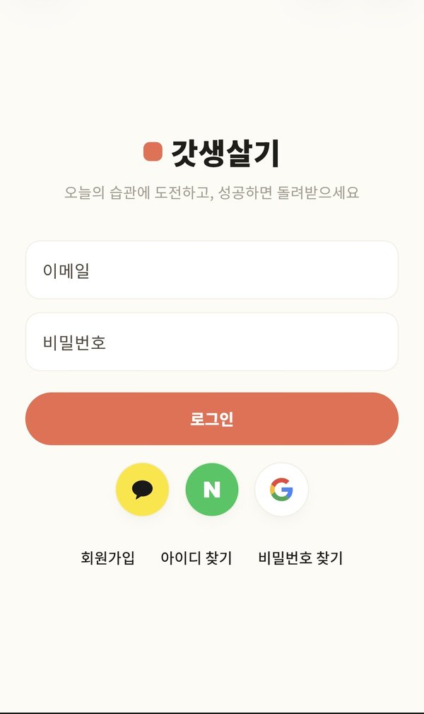
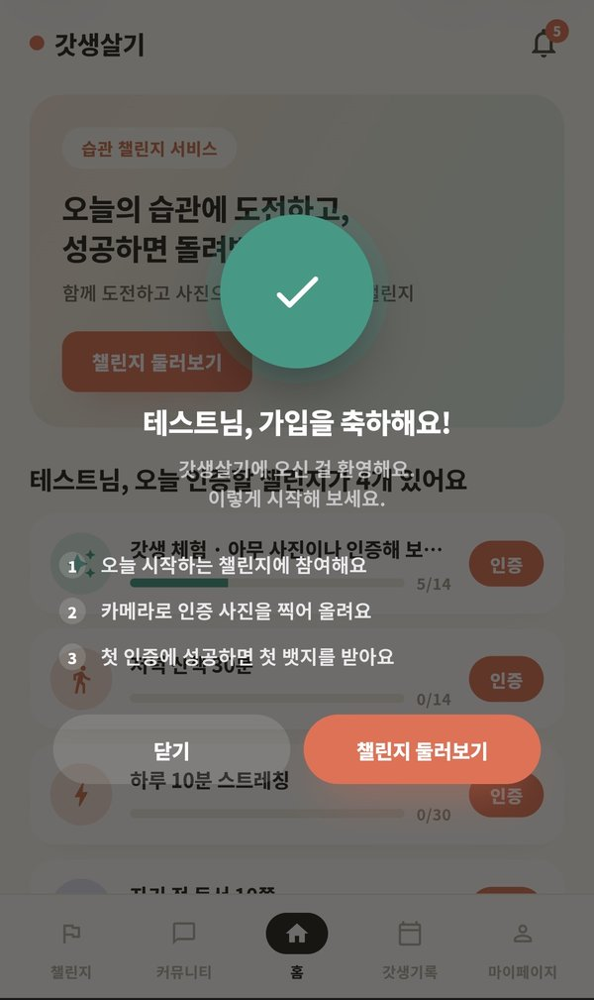
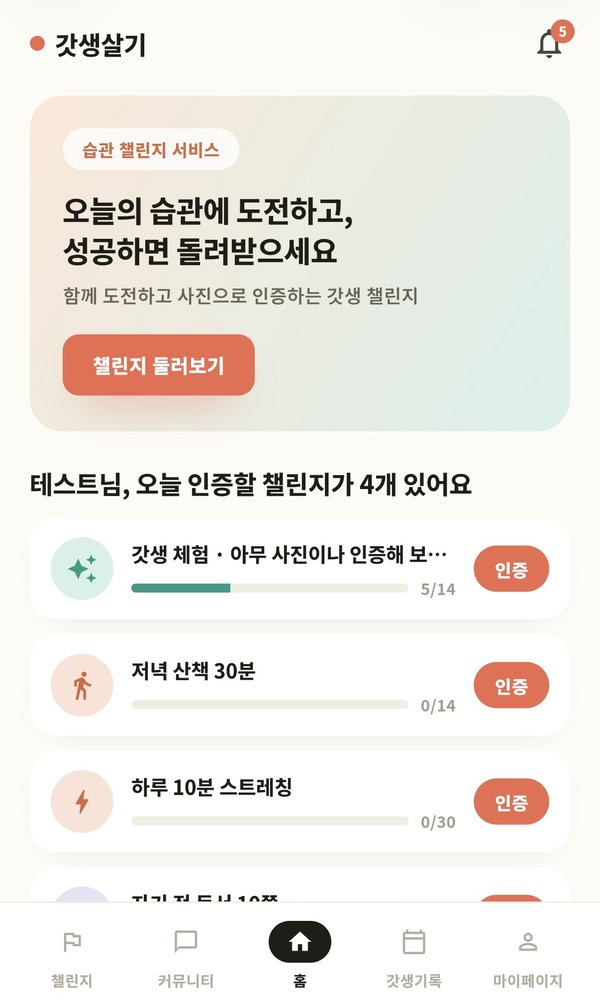
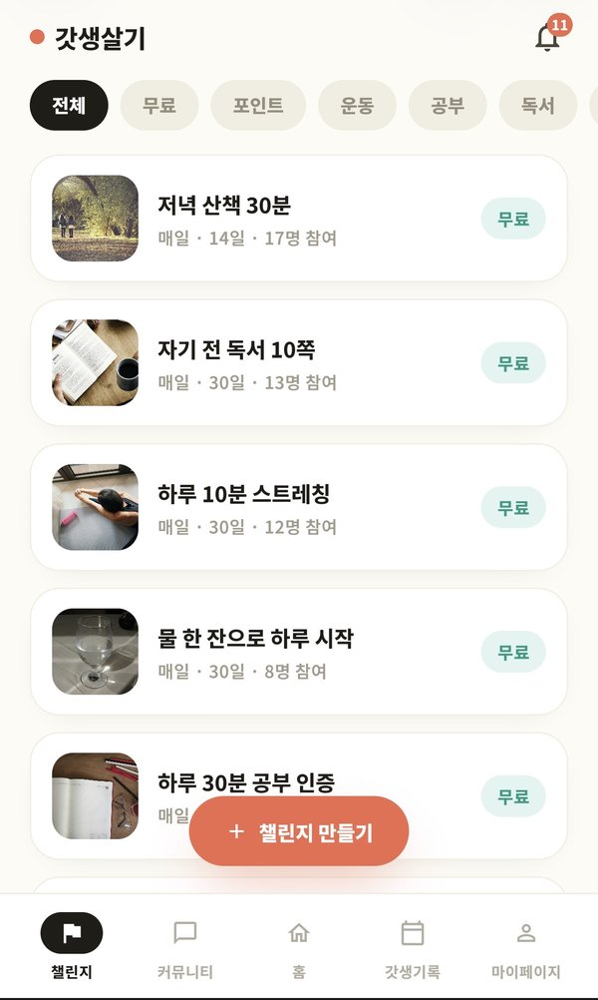
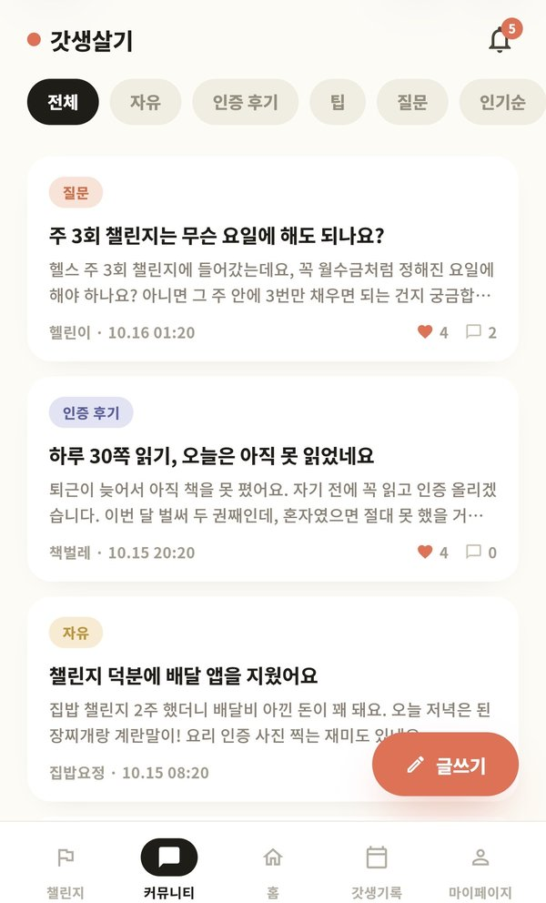
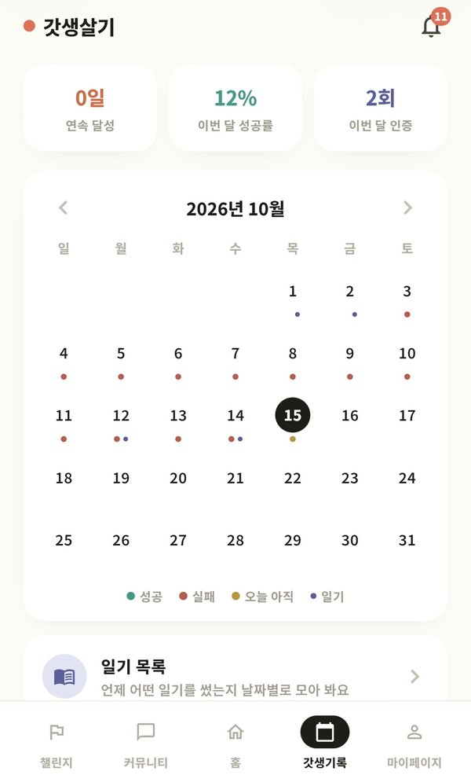
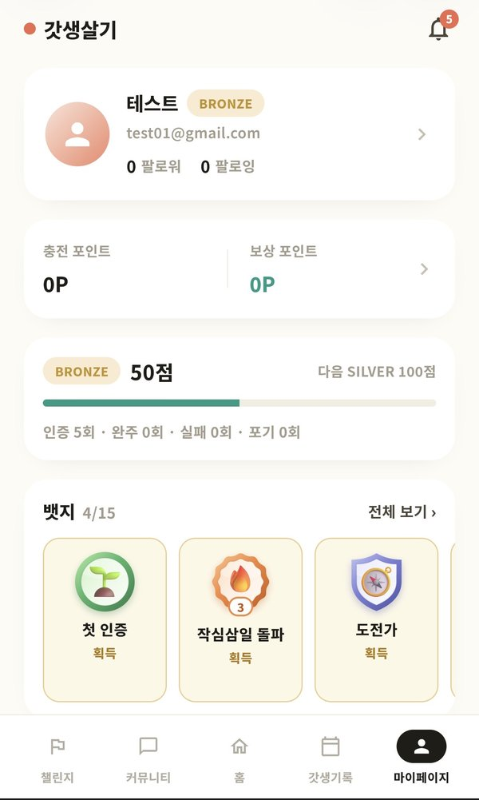
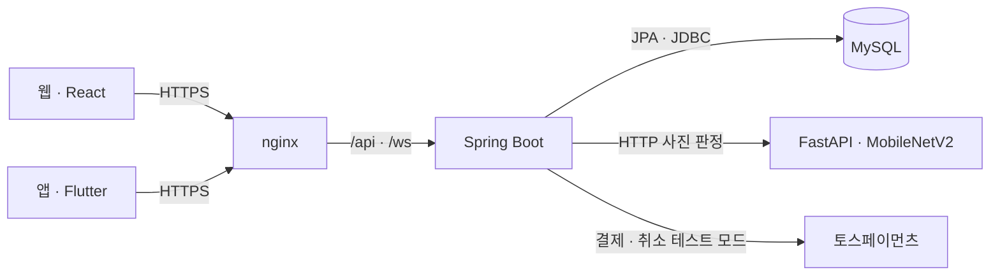

# 갓생살기 (GodLife)

습관 챌린지 서비스입니다. 운동 · 공부 · 독서 같은 챌린지에 포인트를 걸고, 매일 사진으로 인증합니다.
끝까지 해낸 사람은 건 포인트를 그대로 돌려받고, 해내지 못한 사람의 포인트는 해낸 사람들에게 **보상 포인트**로 나눠집니다.

부트캠프 과제로 만든 풀스택 개인 프로젝트입니다. 웹(React)과 앱(Flutter)이 같은 백엔드를 씁니다.

- 배포: https://mygodlife.duckdns.org (폰으로 열면 앱 화면, 컴퓨터로 열면 웹사이트. 시연할 때만 서버를 켭니다)
- 안드로이드 APK: [Releases 의 app-latest](https://github.com/nae442939-prog/GodLife/releases/tag/app-latest) (main 에 합쳐질 때마다 GitHub Actions 가 다시 빌드)

### 테스트 계정

가입하려면 휴대폰 인증이 필요해서, 바로 둘러볼 수 있는 계정을 준비해 두었습니다.

| 계정 | 아이디 | 비밀번호 | 할 수 있는 것 |
|---|---|---|---|
| 일반 회원 | `test@godlife.test` | `test1234` | 챌린지 참여, 사진 인증, 커뮤니티, 포인트 상점 (보상 포인트 50,000P, 체험 챌린지 기록이 들어 있음) |
| 관리자 | `admin@godlife.test` | `admin1234` | 관리자 화면 보기 (AI 검토, 신고, 문의, 상점 주문). 처리 버튼은 막혀 있고, 회원 개인정보는 가려서 보입니다 |

- 여러 분이 같이 쓰는 계정이라 비밀번호 변경과 찾기, 휴대폰 등록, 탈퇴는 막아 두었습니다.
- 매일 새벽 4시에 처음 상태로 돌아갑니다 (그 시간에 서버가 꺼져 있었으면 켜질 때).
- 서버는 비용 때문에 시연할 때만 켭니다. 접속이 안 되면 지원서의 연락처로 알려 주시면 바로 켜겠습니다.

## 화면 (안드로이드 앱)

| 로그인 | 가입 축하 | 홈 | 챌린지 |
|---|---|---|---|
|  |  |  |  |

| 커뮤니티 | 갓생기록 | 마이페이지 |
|---|---|---|
|  |  |  |

## 핵심 설계

**직접 학습한 AI 로 인증 사진을 검증합니다.**
외부 AI API 를 부르지 않습니다. ImageNet 으로 학습된 MobileNetV2 를 공개 데이터셋(Stanford 40 Actions)과 웹에서 모은 사진으로 전이학습(파인튜닝)해서, 따로 띄운 FastAPI 서버에서 추론합니다.
사진이 챌린지 카테고리와 맞는지 판정하고, 이미지 임베딩의 유사도로 같은 사진 재사용을 잡아내며, 애매한 사진은 관리자 검토로 넘깁니다.
사진 모양이 제각각인 '기타' 카테고리는 세부 종류(일찍 일어나기 · 산책 · 물 마시기 · 청소/정리 · 식물 가꾸기)로 나눠 학습해, 개설자가 고른 종류로 판정합니다.

| 항목 | 내용 |
|---|---|
| 모델 | MobileNetV2 (ImageNet1K_V2) → 분류층만 학습 8 에폭 → 전체 미세조정 6 에폭 |
| 라벨 (10개) | 운동 · 공부 · 독서 · 요리 + 기타 세부 5종 + 어디에도 안 맞는 사진(`other`) |
| 데이터 | 사진 8,747장 (학습 7,003 / 검증 1,744) |
| 검증 정확도 | **85.2%** (라벨별 혼동 행렬은 [metrics.json](ai-server/models/godlife-mobilenetv2.metrics.json)) |

모델이 틀릴 수 있다는 전제로, 판정을 바로 확정하지 않고 확신도에 따라 세 갈래로 나눴습니다 ([AiVerifier.java](backend/src/main/java/com/godlife/backend/verification/ai/AiVerifier.java)).

| 결과 | 조건 |
|---|---|
| 바로 통과 | 챌린지 카테고리와 같은 라벨, 확신도 60% 이상 |
| 바로 거절 (다시 찍기) | 다른 라벨을 85% 이상으로 확신하거나, 챌린지 카테고리 점수가 30% 미만. 하루 5번을 넘으면 거절 대신 검토로 |
| 관리자 검토 | 그 사이의 애매한 사진, 또는 예전 인증 사진과 임베딩 코사인 유사도 0.985 이상(같은 사진 재사용 의심) |
| 건너뜀 | AI 서버가 꺼져 있으면 AI 없이 인증을 받음 (서비스가 AI 서버에 묶이지 않게) |

**도박이 되지 않도록 닫힌 포인트 경제로 설계했습니다.**
- 결과가 우연이 아니라 본인의 인증(노력)으로 정해집니다.
- 현금 출금 · 환전 기능이 없습니다. 보상 포인트는 포인트 상점에서만 쓸 수 있습니다.
- 예외는 하나뿐입니다: 본인이 직접 충전하고 쓰지 않은 금액의 결제 취소(환불).
그래서 포인트 원장은 출처(충전 / 보상 / 상점)를 나눠 기록하고, 환불은 충전분만 대상으로 합니다.

**포인트가 두 번 나가지 않게 했습니다.**
정산 · 결제 · 주문은 DB 트랜잭션 + 행 잠금(`SELECT ... FOR UPDATE`) + 멱등 키로 처리합니다.

## 기능

| 영역 | 내용 |
|---|---|
| 계정 | 이메일 가입 · 로그인, 카카오 · 구글 · 네이버 소셜 로그인, 휴대폰 본인인증(계정당 1개), 아이디 · 비밀번호 찾기, 자동 로그인, 회원 탈퇴 |
| 챌린지 | 개설(무료 / 포인트, 매일 / 주 N회, 인증 가능 시간대, 기타 세부 종류), 둘러보기 · 검색 · 정렬, 비공개 챌린지와 초대 링크, 진행 관리(자정 배치) |
| 인증 | 카메라 직촬 사진 인증, 서버 수신 시각 기준 판정, AI 자동 판정, 재사용 사진 탐지, 관리자 검토, 인증 신고 |
| 포인트 | 지갑(충전 · 보상 분리), 거래 원장, 매일 정산 결과 · 종료 시 일괄 지급, 토스페이먼츠 결제(테스트 모드) · 결제 취소 환불 |
| 랭킹 | 전체 · 친구 · 내 챌린지 랭킹, 주간 · 월간 시즌 랭킹(상위 3명 보너스), 칭호(티어) 승급 · 강등 |
| 갓생기록 | 일기장 · 일기 목록, 성공 · 실패 캘린더(날짜를 누르면 그날 미션 결과와 일기), 주간 회고 리포트(성공률 · 요일별 · 챌린지별 · 코칭 문구) |
| 뱃지 | 기록으로 계산하는 뱃지 15개(인증 횟수 · 연속 인증 · 완주 · 활동)와 관리자 뱃지, 하나를 골라 이름 옆에 착용, 새 뱃지를 따면 축하 창 |
| 소셜 | 팔로우, 1:1 메시지와 메시지 요청, 챌린지 오픈채팅(WebSocket 실시간 알림), 커뮤니티(글 · 사진 · 댓글 · 좋아요 · 신고), 차단 |
| 포인트 상점 | 상품 · 찜 · 장바구니 · 주문 · 주문 취소, 관리자 상품 · 주문 관리 |
| 알림 | 알림함, 종류별 켜기/끄기, 브라우저 푸시 알림(웹 푸시) |
| 부정행위 방지 | 담합 의심 표시, 기기 핑거프린팅(같은 기기 · IP 다중 계정 표시), 요청 횟수 제한 |
| 관리자 | 인증 검토, 담합 의심, 다중 계정 의심, 커뮤니티 신고, 포인트 상점, 1:1 문의 (웹 · 앱) |
| 처음 온 사람 | 회원가입 축하 창, 시작일 안내(언제부터 인증할 수 있는지), 테스트 서버에서는 가입하자마자 체험 데이터 · 환영 알림 |

### 모바일 앱 (Flutter)

웹과 같은 API 로 폰에서 매일 쓰는 흐름을 담았습니다: 오늘 인증할 챌린지, 카메라 인증, 챌린지 만들기 · 대표 사진, 오픈채팅,
1:1 메시지 · 팔로우, 커뮤니티, 랭킹(시상대), 갓생기록 · 일기 목록, 뱃지 · 주간 회고, 프로필 수정, 관리자 화면.
충전 · 결제와 상점처럼 웹에만 있는 화면은 앱 안에서 웹 화면으로 이어지고, 그때도 아래 탭 · 뒤로 가기 · 색을 앱과 같게 맞췄습니다.
자세한 화면 목록은 [mobile/README.md](mobile/README.md) 에 있습니다.

## 기술 스택

| 영역 | 스택 |
|---|---|
| Frontend | React 19 + Vite (JavaScript) |
| Mobile | Flutter (Dart) — 안드로이드 APK, 모바일 웹 빌드 |
| Backend | Java 21 + Spring Boot 4 (Maven), Spring Security(JWT), JPA + JDBC, MySQL 8 |
| AI 서버 | Python + FastAPI + PyTorch (MobileNetV2 전이학습 모델 서빙) |



AI 서버를 따로 둔 이유는 Java 에서 PyTorch 로 학습한 모델을 직접 돌릴 수 없기 때문입니다. 백엔드가 HTTP 로 호출하고, AI 서버가 꺼져 있으면 AI 판정만 건너뜁니다.

## 폴더 구조

```
backend/ Spring Boot (기능별 패키지: auth, challenge, verification, settlement, wallet, ...)
frontend/ Vite + React
mobile/ Flutter 앱 (안드로이드 · 모바일 웹, 자세히는 mobile/README.md)
ai-server/ FastAPI 추론 서버, training/ 에 학습 스크립트와 노트북
db/ 00-init.sql(DB · 계정) → 01-schema.sql(테이블) → 02-seed.sql(기준 데이터), migrations/(변경 이력)
docs/ erd.md (스키마에서 자동 생성한 ERD: python docs/gen-erd.py), erd.html (초기 시안)
deploy/ nginx 설정 사본, server/ 배포 서버 홈의 스크립트 (웹 · 앱 빌드 올리기)
```

DB 구조는 [docs/erd.md](docs/erd.md) 에 있습니다.

## 실행 방법

준비물: JDK 21, Node.js, Python 3.12, MySQL 8

### 1. DB

```bash
# db/00-init.sql 의 CHANGE_ME 를 본인이 정한 비밀번호로 바꾼 뒤 (바꾼 채로 커밋하지 않습니다)
mysql -u root -p < db/00-init.sql
mysql -u godlife_user -p godlife < db/01-schema.sql
mysql -u godlife_user -p godlife < db/02-seed.sql
```

화면을 채울 더미 데이터(선택)는 `db/dev-dummy.sql` · `db/dev-recruiting.sql` · `db/dev-today-start.sql` 등으로 넣습니다.
이미 만든 DB 는 `db/migrations/` 의 파일을 번호 순서대로 적용합니다.

테스트 · 시연용 설정 (`backend/.env`, 기본은 모두 꺼짐):

| 설정 | 하는 일 |
|---|---|
| `DEMO_KEEP_DATES=true` | 더미 데이터의 날짜를 매일 오늘에 맞춰 민다 → 날짜가 지나도 모집 중 · 진행 중 챌린지와 랭킹이 그대로 보인다 (실제 회원의 기록은 건드리지 않는다) |
| `DEMO_STARTER_DATA=true` | 가입하면 체험 데이터를 넣는다: 오늘 시작하는 무료 챌린지 3개 참여 + 지난 6일 기록이 있는 본인만 보는 '갓생 체험' 챌린지 + 환영 알림. 포인트는 건드리지 않는다 |
| `DEMO_USER_EMAIL`, `DEMO_USER_PASSWORD`, `DEMO_ADMIN_EMAIL`, `DEMO_ADMIN_PASSWORD` | 위의 테스트 계정을 만든다 (비워 두면 안 만든다). 매일 새벽 4시에 예전 계정을 탈퇴 처리하고 같은 아이디로 새로 만든다. 관리자 계정은 보기만 된다 |

### 2. 백엔드 (http://localhost:8080)

```bash
cp backend/.env.example backend/.env # 값 채우기: DB 비밀번호, JWT_SECRET, PHONE_HMAC_SECRET 은 필수
cd backend
./mvnw spring-boot:run
```

소셜 로그인 · 결제 · 메일 · 푸시 알림 키는 비워 두어도 서버가 뜹니다. 그 기능만 꺼집니다.

### 3. AI 서버 (http://localhost:8000)

```bash
cd ai-server
python -m venv venv
venv\Scripts\activate # macOS / Linux: source venv/bin/activate
pip install -r requirements.txt
uvicorn main:app --port 8000
```

학습한 모델(`ai-server/models/godlife-mobilenetv2.pt`)은 저장소에 들어 있어 바로 추론할 수 있습니다.
모델 파일이 없으면 서버는 뜨지만 판정을 하지 않고, 백엔드는 AI 판정 없이 인증을 받습니다.
다시 학습하려면 `ai-server/training/` 의 스크립트나 노트북을 씁니다 (학습 사진은 저장소에 없습니다).

### 4. 프론트엔드 (http://localhost:5173)

```bash
cd frontend
npm install
npm run dev
```

개발 서버가 `/api` · `/ws` 요청을 백엔드로 넘겨 주므로 브라우저에서는 5173 번만 열면 됩니다.

### 5. 모바일 앱 (Flutter)

준비물: Flutter SDK, Android SDK

```bash
cd mobile
flutter pub get
flutter test # 단위 테스트
flutter run # 연결된 폰 · 에뮬레이터에서 실행
flutter build apk --release # build/app/outputs/flutter-apk/app-release.apk
```

기본으로 배포 서버를 보고, 다른 서버에 붙이려면 `--dart-define=API_BASE=...` 로 지정합니다.
아이폰처럼 APK 를 깔 수 없는 기기에서는 같은 코드를 웹으로 빌드해 브라우저로 엽니다.
화면 구성과 자세한 실행 방법은 [mobile/README.md](mobile/README.md) 에 있습니다.

## 테스트

```bash
cd backend
./mvnw test
```

테스트는 개발 DB 가 아니라 `godlife_test` DB 를 씁니다. 같은 스키마(`01-schema.sql`)와 기준 데이터(`02-seed.sql`)를 넣어 두어야 합니다.
백엔드 통합 테스트 239개, 앱 단위 테스트(`flutter test`)가 있습니다.

## 배포

AWS EC2(t3.small, Ubuntu) 한 대에 nginx · Spring Boot(systemd) · FastAPI(systemd) · MySQL 을 올렸고, 주소는 DuckDNS + Let's Encrypt 입니다.
nginx 가 폰으로 들어온 요청은 앱 화면(`/app/`, Flutter 웹 빌드)으로, 컴퓨터는 웹사이트(React 빌드)로 보냅니다 ([deploy/nginx-godlife.conf](deploy/nginx-godlife.conf)).

올리는 순서: DB 변경(`db/migrations/`)이 있으면 먼저 적용 → 백엔드 jar 교체 후 재시작 → `deploy/server/deploy-web.sh` · `deploy-app.sh` 로 웹 · 앱 빌드 교체.
